<picture>
  
</picture>

### Sobre mim

Sou Gabriel Garabedian, estudante de **Análise e Desenvolvimento de Sistemas na UNINASSAU**, em Recife. Estudo **DevOps na FAP** e desenvolvo projetos para colocar o aprendizado em prática.

Meu foco é back-end com **Java, Spring Boot, SQL e Python**. Também trabalho com **HTML, CSS e JavaScript** para construir experiências web completas.

[LinkedIn](https://www.linkedin.com/in/garabedi4n) · [Repositórios](https://github.com/Gabriel-Garabedian?tab=repositories) · [Como estes cartões são gerados](./DESIGN.md)
